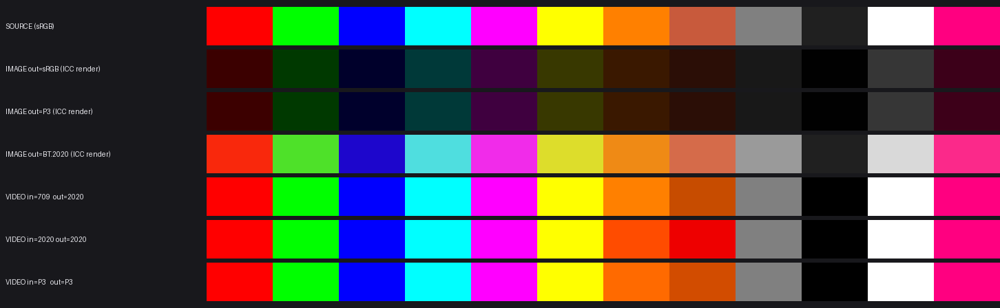
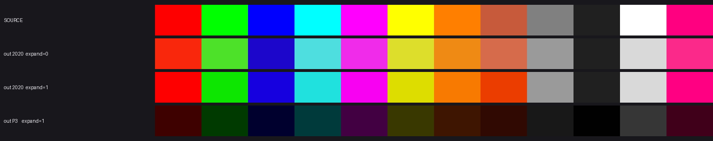

# 调研：图片侧切换「输出色域」为什么不拓展色彩（vs 视频侧）

> 结论先行：**图片侧是「转换色域」（convert），视频侧是「指定色域」（assign）**。前者只把同一批颜色换到更大的容器里再打 ICC，观感必然不变；后者把「源素材该按哪个色域解码」也一起改了，等于把 BT.709 的码值当成 BT.2020 来解释，颜色才会真的外扩。视频侧的「拓展」其实是**解读错误带来的过饱和**，不是用上了更大色域。
>
> 附带发现：图片侧还有一个更实际的问题——**源图自带的广色域被丢弃了**（ICC 路径不消费 `colorspace::detect` 的结果），P3 源转 BT.2020 实测掉 15–19% 彩度。所以图片侧不只是「不拓展」，还会小幅缩水。

---

## 1 两条链路的参数语义（代码事实）

### 1.1 图片侧：只有一个「输出色域」，纯输出转换

| 环节 | 代码 | 行为 |
|---|---|---|
| UI | `views/image.html:128-131`（`#outputGamut`：BT.2020 / P3 / sRGB） | 只有输出色域，**没有输入色域/内容信号**控件 |
| settings | `views/image.html:585-599` | 只上报 `outputGamut`，不含 `inputPrimaries` |
| IPC | `main.js:548-557` | settings 原样透传 `/convert` |
| 输入解读 | `convert.rs:91` → `InputCodec::from_settings`（`colorspace.rs:644-649`） | `input_transfer/input_primaries = None` → 固定按 sRGB/BT.709 解码 |
| 输出转换 | `convert.rs:129-142` | 线性光上乘 **BT.709→P3 / BT.709→2020** 矩阵 |
| ICC | `lib.rs:393-409`、`convert.rs:93-95` | 按 `output_gamut` 选 profile：2020 用 `assets/2020_profile.icc`，P3/sRGB 程序化生成 PQ profile |
| 预览 | `server.rs:449-457` → 同一 `encode_image_bytes` | 预览与导出同一条像素管线，PNG/JPEG 带 ICC |

矩阵就是标准的 colorimetric 转换（sRGB→P3、sRGB→2020 的经典数值），作用只是「同一颜色换坐标」。

### 1.2 视频侧：「色域」= 输入解读 + 输出编码（合并语义）

| 环节 | 代码 | 行为 |
|---|---|---|
| UI | `views/video.html:207-208` | 标签原文就是 **「色域（输入解读 + 输出编码）」** |
| 导出 | `views/video.html:1043-1044, 1068` | 下拉值同时写进 `inputPrimaries` 和 `outputPrimaries` |
| 预览 | `views/hdr_preview_media.js:635`（`primariesConvert`）、`:785`（`texture_primaries`） | 预览按同一个「内容色域」解释画面 |
| 逐帧后端 | `video.rs` → `reconstruct_linear_hdr_transform`（`ultra_hdr.rs:348-356`） | 每帧先走 `InputCodec::to_linear`：**把码值当成用户选的色域来解码**，再换算到 BT.709 线性 |
| 编码 | `video_converter.js:466-468` | `zscale ... pin=bt709 p=<输出色域>`：输出侧仍是 colorimetric 转换 |

关键：帧进入 zscale 之前**已经是 BT.709 线性**（后端已按输入解读矩阵换算过）。所以视频的「颜色变化」全部来自后端那一步**解读**，输出矩阵只是把结果装进 BT.2020/P3 容器。

一句话对照：

- 图片：`709 码值 →（当成709解码）→ 709 线性 → 矩阵 → 2020 码值 + 2020 ICC` = **convert**，观感不变。
- 视频：`709 码值 →（当成2020解码）→ 709 线性（已被推到色域边界）→ 矩阵 → 2020 码值` = **assign**，观感变艳。

---

## 2 数学：为什么「转换」永远不拓展色彩

设源颜色为 XYZ。转换只做 `XYZ → 目标 RGB = M⁻¹·XYZ`，XYZ 不变 → 色度不变、饱和度不变。色域矩阵能做的只有「不裁剪」：让原本会被 sRGB 裁掉的颜色在 P3/2020 里存活下来。

要让颜色真的变艳，必须显式做 **gamut extension（色度拉伸）**：在感知均匀空间（Oklab / IPT / CAM16）里把 chroma 乘 k>1，再压回目标色域边界。**调研时的代码里没有任何这样的步骤**（2026-10 已在 ICC 路径补上，见 §6）：

- `convert.rs`：`tone_gain(y)` 对 r/g/b 乘**同一个**增益（`ultra_hdr.rs:151-157`）→ 只改亮度，色度严格不变；
- 视频的 `reconstruct_linear_hdr_transform` 也是逐通道同增益，gamma 默认 1.0（视频页 `video.html:1050`）；
- `colorspace.rs` 只有「输入→709」矩阵；`convert.rs` 只有「709→输出」矩阵；
- 全仓库搜 `saturat|chroma.*boost|gamut.*extend|oklab` 无实现（调研时；现在 `convert.rs` 已有 Oklab gamut extension）。

---

## 3 实测

素材：12 个色块（纯基色 + 二次色 + 混合色 + 灰阶），576×192。脚本与产物在 `experiments/gamut_research/`。



> 图：第 1 行源图；2–4 行图片三色域经 ICC 渲染回 sRGB；5–7 行视频三种「色域」组合解码回 sRGB。第 2/3 行发暗是第 4 节说的 ICC 语义不一致，不是色域问题。

### 3.1 图片：切输出色域，色度不变（Δu′v′ ≈ 0）

`sRGB → png，--peak 574 --white-point 203`，解码回 BT.709 线性后比 CIE 1976 u′v′：

| 色块 | out=sRGB 码值 | out=P3 码值 | out=2020 码值 | Δu′v′（P3） | Δu′v′（2020） | 彩度（三者/源） |
|---|---|---|---|---|---|---|
| 红 255,0,0 | 169,0,0 | 164,84,71 | 156,100,70 | 0.0000 | 0.0001 | 0.259 / 0.259 |
| 绿 0,255,0 | 0,167,0 | 121,166,100 | 137,165,104 | 0.0001 | 0.0000 | 0.119 / 0.119 |
| 蓝 0,0,255 | 0,0,153 | 0,0,151 | 78,53,150 | 0.0000 | 0.0007 | 0.311 / 0.311 |
| 橙 255,128,0 | 168,127,0 | 164,130,83 | 158,133,85 | 0.0011 | 0.0020 | 0.141 / 0.141 |
| 粉 255,0,128 | 170,0,129 | 165,85,129 | 158,102,128 | 0.0007 | 0.0022 | 0.200 / 0.200 |

**码值差异很大，颜色一模一样**——这正是 colorimetric 转换的定义。切广色域在图片侧只改变「数字怎么记」，不改变「看到什么」。

### 3.2 图片：源图的广色域被丢掉（真正的问题）

造一张 Display-P3 编码、带 P3 ICC 的源图（`colorspace::detect` 能正确识别为 `Display-P3 (D65)`），转 BT.2020：

| 色块 | P3 真实彩度 | 管线输出彩度 | 损失 |
|---|---|---|---|
| 红 255,0,0 | 0.3040 | 0.2586 | **14.9%** |
| 绿 0,255,0 | 0.1477 | 0.1191 | **19.4%** |
| 橙 255,128,0 | 0.1688 | 0.1390 | **17.7%** |
| 混合 200,90,60 | 0.1659 | 0.1381 | **16.7%** |
| 粉 255,0,128 | 0.2351 | 0.2010 | **14.5%** |

原因：ICC 路径的 `InputCodec` 只看 `settings.input_primaries`，图片页从不传；**探测到的输入色域只被 Ultra HDR 主图 ICC 使用**（`lib.rs:115-117` 走 `detect`，但 `convert.rs` 的 png/jpg_icc 路径不用）。于是 P3 码值被当成 sRGB 解码 → 先被压进 sRGB 色域，再装进 BT.2020 容器。

### 3.3 视频：切「色域」= 改输入解读 → 颜色真的外扩

同一条 BT.709 SDR 素材（10 fps/2 s），走真实 JS 链路（`convertVideoDirect` + Rust `/video-frame`，x265 crf 12），只改「色域」下拉：

| 组合 | Δu′v′（纯基色） | 橙 255,128,0 彩度 | 混合 200,90,60 彩度 |
|---|---|---|---|
| in=709 / out=2020（正确） | 0.0000 | 0.141（= 源 0.141） | 0.174（源 0.137，含 4:2:0 抽样误差） |
| in=2020 / out=2020（错当 2020） | 0.0000 | **0.203（+44%）** | **0.259（+89%）** |
| in=P3 / out=P3（错当 P3） | 0.0000 | 0.166（+18%） | 0.181（+32%） |

纯基色不变（已在色域边界，钳住），**二次色/混合色被明显推出**——这就是肉眼看到的「视频侧真的拓展了色彩」。代价是：对真正的 709 素材，这是**解读错误**，颜色已经过量；换到 P3/2020 显示器上会更明显。

### 3.4 附带发现：三种图片色域的 ICC 语义不一致

用 lcms2（Chromium/Skia 同族 CMM）把输出图按自带 ICC 渲染回 sRGB：

| 输出色域 | ICC 类型 | 渲染结果 | 结论 |
|---|---|---|---|
| BT.2020 | `assets/2020_profile.icc`，Google mAB LUT（含烘焙的参考渲染曲线） | 红 → (249,40,12)，彩度 0.237（源 0.259） | 亮度正常，**彩度 −8~15%**，Δu′v′ 0.011–0.026 |
| Display P3 | 程序化 矩阵+PQ `curv` | 红 → (60,0,0) | 色度准确（Δu′v′ ≤ 0.003），但 SDR CMM 无绝对亮度映射 → **整体发暗**（574 nit 被当 5.7% 白） |
| sRGB | 同上 | 红 → (59,0,0) | 同上 |

即：BT.2020 走「看起来正常、略褪色」，P3/sRGB 走「色度正确、发暗」。切色域时亮度会跳变，但**都不是色彩拓展**。这也是图片页预览切 P3 会明显变暗的原因（`image.html:1081-1084` 切换即重生成预览）。

---

## 4 观感差异的三个来源（按贡献排序）

1. **assign vs convert（主因，已实测）**：视频侧下拉同时改输入解读，相当于 Photoshop 的「指定配置文件」；图片侧只改输出，相当于「转换为配置文件」。前者变观感，后者不变。
2. **PQ/BT.2020 触发 HDR 呈现路径**：外播放器对 HDR10 做 tone mapping 时常带饱和度提升（BT.2390 类曲线在低亮度端的色度处理）、HDR 面板本身色域体积更大、高亮度下的 Hunt/Helmholtz–Kohlrausch 效应 → 即使信号是 colorimetric 的，看起来也更艳。
3. **承载方式不同**：图片是「像素 + ICC」，色彩管理后回到原样；视频是「元数据 + 播放器解释」，解释权在播放器（`colr`/`mdcv` 怎么用由它决定）。

---

## 5 建议（按性价比）

1. **图片侧补上「输入色域」语义（bug 级）**：`convert.rs` 的 ICC 路径应消费 `colorspace::detect` 的结果（P3/2020/Adobe 源按真实基色解码），或至少把 `input_primaries` 透传下来；否则广色域照片永远被当 sRGB，白白损失 15–19% 彩度。Ultra HDR 已经这么做了（原汤化原食），ICC 路径没做，属于漏接。
2. ✅ **已实现：显式 gamut extension**（2026-10，见 §6）：`convert.rs::apply_hdr_rec2020_pq` 在 `tone_gain` 之后、输出矩阵之前做 Oklab 色度拉伸；强度 `settings.gamut_expand`（0..1，CLI `--gamut-expand`，默认 1.0）。**Ultra HDR 路径刻意不做**（格式语义只允许亮度变化，见 `ultra_hdr.rs::encode_ultra_hdr` 注释）。
3. **统一三种图片 ICC 的渲染语义**：要么 P3/sRGB 也改用带参考渲染的 LUT profile（与 2020 一致），要么 2020 改成矩阵 profile 并接受 SDR 查看器发暗；现在是「换色域 = 换亮度语义」，容易被误读成色域效果。
4. **视频侧拆分「输入解读」与「输出编码」**：现在合并，用户选宽色域就静默改了解读，产生假拓展；拆开后选错会有明确提示（或直接跟源自动检测），也和图片侧语义对齐。

---

## 6 已落地：ICC 路径的色域拓展（2026-10）

### 6.1 算法

`convert.rs` 新增（仅 png / jpg_icc；ULTRA HDR 不走）：

1. 逐像素在线性 BT.709 上归一化（`rgb / max(rgb)`）；
2. 转 **Oklab**，取 `(L, h, C)`；
3. 查预计算的 **33×65 ≪L, hue≫ 比值表**：`k = C_max(目标色域, L, h) / C_max(sRGB, L, h)`（两侧都用二分求「仍落在各自 RGB 立方体内的最大 Oklab 彩度」）；
4. 色度拉伸：`C' = C · (1 + s·(k−1))`，`s = settings.gamut_expand`（默认 1.0 = 满色域映射，0 = 旧行为）；
5. Oklab → 线性 BT.709 → 原 BT.709→目标色域矩阵 → PQ。

色相与明度不变（Oklab 色相角不动），亮度按归一化系数缩放回去；sRGB 输出走恒等矩阵，直接跳过（不建表）。

### 6.2 实测（同一 12 色块）



> 图：第 1 行源图；第 2 行 2020 expand=0（旧行为，略褪色）；第 3 行 2020 expand=1；第 4 行 P3 expand=1（发暗是 §3.4 的 ICC 语义问题，不是拓展本身）。

| 输出 | 红 | 绿 | 橙 | 混合 200,90,60 | 灰/白 |
|---|---|---|---|---|---|
| 2020, expand=0（旧） | 0.259 | 0.120 | 0.139 | 0.138 | 0 |
| 2020, expand=1 | **0.315** | **0.146** | **0.174** | **0.241** | 0（不变） |
| P3, expand=1 | 0.304（= P3 红边界 0.304） | 0.136 | 0.170 | 0.183 | 0 |
| 2020, expand=1，P3 显示器上渲染 | 0.298（sRGB 输出 0.258，源 0.304） | 0.135 | 0.190 | — | 0 |

- 在 **sRGB 显示器**上，2020 文件被色彩管理裁回 sRGB 边界，观感 ≈ 原图（0.259）——这是物理限制；
- 在 **P3/2020 显示器**上才看到真实增益（红 0.258 → 0.298），且落在源图应有的 P3 表现附近；
- 中性色（灰/白）逐字节不变；1080p 单张耗时 86 ms → 111 ms（+29%，主要是逐像素 Oklab）。

### 6.3 为什么 Ultra HDR 不参与

Ultra HDR 的 HDR 信息全部在**增益图**里：单通道 log2 增益、对 R/G/B 乘**同一个**系数（`hdr = sdr · 2^gain`），只改亮度、色度守恒；规范同时规定 **HDR 图色彩空间 = SDR 主图色彩空间**（主图 ICC 即声明，见 `colorspace.rs` 顶部引文）。增益图元数据里也没有「目标色域」字段。因此在该侧做色度拉伸：
1. 违反格式语义——解码端只会按主图 ICC 解释，拉伸后的颜色没有声明可依；
2. 与 `output_gamut` 无关——Ultra HDR 的输出色域由主图像素/ICC 决定（原汤化原食），UI 也对该格式隐藏了「输出色域」。

代码位置：`ultra_hdr.rs::encode_ultra_hdr` 文档注释（详细说明）+ `lib.rs::encode_image_bytes`（提前返回，连变换都不做）。

---

## 6 复现

```powershell
# 后端（视频链路需要）
.\backend\rust\target\release\hdrconv.exe serve --port 45999

# 图片：三色域 + P3 源
.\backend\rust\target\release\hdrconv.exe experiments\gamut_research\patches_srgb.png -o experiments\gamut_research\out_srgb.png -f png --output-gamut srgb --peak 574 --white-point 203
.\backend\rust\target\release\hdrconv.exe experiments\gamut_research\patches_srgb.png -o experiments\gamut_research\out_p3.png   -f png --output-gamut p3   --peak 574 --white-point 203
.\backend\rust\target\release\hdrconv.exe experiments\gamut_research\patches_srgb.png -o experiments\gamut_research\out_2020.png -f png --output-gamut 2020 --peak 574 --white-point 203
.\backend\rust\target\release\hdrconv.exe experiments\gamut_research\p3_source.png -o experiments\gamut_research\p3_source_hdr2020.png -f png --output-gamut 2020 --peak 574 --white-point 203

# 视频：三种「色域」组合（真实 JS 链路）
node experiments\gamut_research\run_video_paths.js

# 度量（python 用 DSH 自带运行时）
python experiments\gamut_research\analyze.py            # 3.1 表
python experiments\gamut_research\analyze_p3_input.py   # 3.2 表
python experiments\gamut_research\analyze_video_paths.py# 3.3 表
python experiments\gamut_research\analyze_icc.py        # 3.4 表
python experiments\gamut_research\make_figure.py        # compare.png
```

产物：`experiments/gamut_research/compare.png`、`out_{srgb,p3,2020}.png`、`video_in*_out*.mp4`、`f_in*_out*.png`、`p3_source*.png`。
